# Henr1sky

**Segurança da informação · Redes e sistemas Linux**

Desenvolvo ferramentas de terminal para investigar o que acontece na rede e no sistema. O **VitaisK** acompanha eventos de um host Linux em tempo real. O **SonarK** ajuda a investigar capturas e logs já coletados.

## Projetos em destaque

| [VitaisK](https://github.com/Henr1sky/VitaisK) | [SonarK](https://github.com/Henr1sky/SonarK) |
| :--- | :--- |
| **Monitoramento em tempo real** | **Análise offline de tráfego e logs** |
| `Python` · `Linux` · `Alfa` | `Rust` · `Linux` · `TShark` |
| Acompanhe eventos do sistema, veja métricas de CPU, RAM e disco e investigue alertas do host em um painel de terminal. | Explore protocolos e consultas DNS em capturas PCAP/PCAPNG, consulte logs locais e exporte resultados de investigações. |
| [Instalação](https://github.com/Henr1sky/VitaisK#requisitos-e-instala%C3%A7%C3%A3o) · [Guia do painel](https://github.com/Henr1sky/VitaisK#painel-e-modo-em-fluxo) | [Instalação](https://github.com/Henr1sky/SonarK#instala%C3%A7%C3%A3o-e-primeiros-passos) · [Manual](https://github.com/Henr1sky/SonarK/blob/main/docs/manual.md) · [Catálogo](https://github.com/Henr1sky/SonarK/blob/main/docs/catalogo.md) |

## Estudos em segurança

**[CTFs-Desec](https://github.com/Henr1sky/CTFs-Desec)** · Registro dos desafios de Capture the Flag (CTF) que resolvi durante minha formação na Desec Security.

[Ver todos os repositórios →](https://github.com/Henr1sky?tab=repositories)
